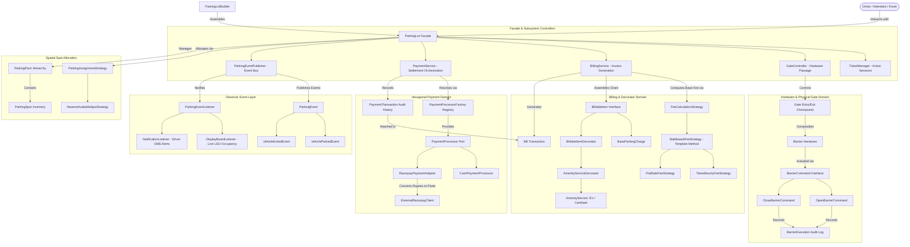
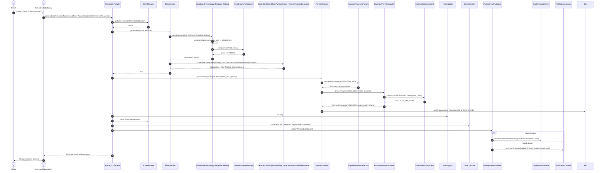
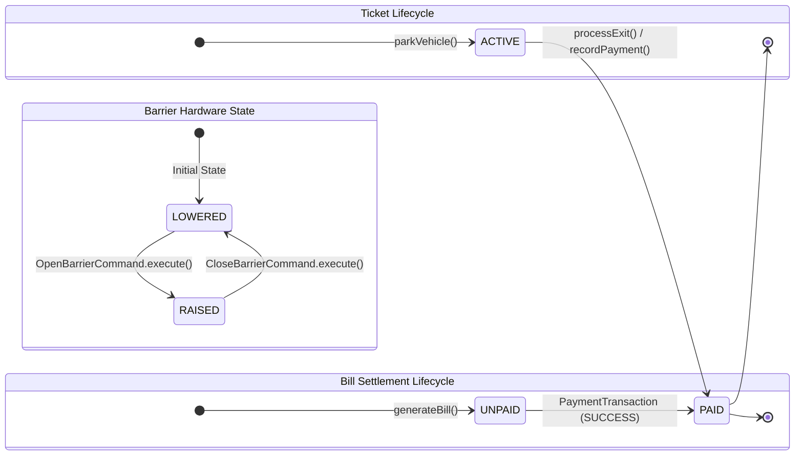

# Comprehensive Architectural Design & Decision Log
## Multi-Floor Parking Lot Low-Level Design (LLD)

### 4.3 Hardware Barrier Command Actuation Sequence
```mermaid
sequenceDiagram
    autonumber
    actor Attendant as Attendant (Carlos)
    participant GC as GateController
    participant OP as OpenBarrierCommand
    participant CL as CloseBarrierCommand
    participant B as Barrier Hardware

    Note over Attendant, B: Vehicle approaches gate; operator actuates barrier
    Attendant ->> GC: openBarrier("E1", operator)
    GC ->> OP: execute(operator)
    OP ->> B: raise()
    OP ->> B: recordExecution(new BarrierExecution("BARRIER-E1", "OPEN_BARRIER", Carlos))
    Note over B: Barrier status is RAISED; audit history recorded

    Note over Attendant, B: Vehicle safely passes induction loop sensor
    Attendant ->> GC: closeBarrier("E1", operator)
    GC ->> CL: execute(operator)
    CL ->> B: lower()
    CL ->> B: recordExecution(new BarrierExecution("BARRIER-E1", "CLOSE_BARRIER", Carlos))
    Note over B: Barrier status is LOWERED; complete audit trail retained
```

---

## 1. System Requirements & Domain Scope

### 1.1 Problem Statement
Design a clean, extensible, multi-floor parking lot system capable of managing high-throughput entry and exit flows, dynamically assigning parking spots based on vehicle dimensions, maintaining transactional bill settlement, calculating tiered hourly fees, supporting dynamic value-added amenities (EV charging, car wash), controlling gate barriers with full operator auditing, and enabling seamless third-party payment integration (e.g. Razorpay).

### 1.2 Core Capabilities
1. **Multi-Floor Capacity**: Multi-level floors, each containing designated spot types (`BIKE`, `CAR`, `TRUCK`).
2. **Strict 1:1 Spot Compatibility**: A car spot cannot accommodate bikes; a truck spot cannot accommodate cars. Each vehicle maps strictly to its dedicated spot type.
3. **Automated Ticket Issuance with Operator Auditing**: Generates an entry record (`Ticket`) containing entry timestamp, assigned spot ID, floor number, vehicle plate, ticket number, and operating attendant / automated kiosk (`User issuedBy`).
4. **Spatial Spot Allocation (Strategy Pattern)**: Nearest available spot across floors (calculated using floor elevation delta first, then 2D Manhattan coordinates) in $O(1)$ lookup time relative to the entry gate.
5. **Tiered Hourly Fee Math (Template Method Strategy)**: Progressive fee calculation with hourly ceiling rounding ($\lceil \text{hours} \rceil$) and configurable operational policies (`ParkingConfiguration`), sealed via a `final` template method in `SlabBasedFeeStrategy`.
6. **Itemized Billing (Decorator Pattern)**: Composable itemized invoices (`BillableItem`, `BaseParkingCharge`, `BillableItemDecorator`, `AmenityServiceDecorator`) enabling dynamic runtime decoration of parking fees with EV charging and car wash amenities.
7. **Hardware Actuation (Command Pattern)**: Gate barriers operated via encapsulated commands (`OpenBarrierCommand`, `CloseBarrierCommand`) with complete operator accountability and audit logging.
8. **Real-Time Event Bus (Observer Pattern)**: Event-driven notifications (`VehicleParkedEvent`, `VehicleExitedEvent`) decoupled into pluggable listeners (`DisplayBoardListener`, `NotificationListener`).
9. **Payment Gateway Integration (Hexagonal Adapters & Registry Pattern)**: Pluggable payment processors (Razorpay adapter, Cash) resolved through a dynamic `PaymentProcessorFactory` registry, recording transactional audit trails (`PaymentTransaction`).

---

## 2. Design Patterns Applied & Rationale

| Pattern | Category | Where Applied | Concrete Architectural Justification |
| :--- | :--- | :--- | :--- |
| **Facade** | Structural | `ParkingLot` class | Hides complex subsystem orchestration (`GateController`, `TicketManager`, `BillingService`, `PaymentService`, `ParkingEventPublisher`) behind clean facade entry points. |
| **Strategy (x2)** | Behavioral | `ParkingAssignmentStrategy`<br>`FeeCalculationStrategy` | **1.** Swaps spatial search heuristics (Nearest Available Spot vs Random) in $O(1)$.<br>**2.** Swaps mathematical fee algorithms (Progressive Tiered Slabs vs Flat Rate). |
| **Command** | Behavioral | `BarrierCommand`<br>`OpenBarrierCommand`<br>`CloseBarrierCommand` | Encapsulates barrier hardware movements into discrete executable objects, enabling audit logging of every operator/kiosk actuation. |
| **Decorator** | Structural | `BillableItemDecorator`<br>`AmenityServiceDecorator` | Dynamically decorates `BaseParkingCharge` with value-added amenities (EV charging, car wash) using the Template Method pattern inside the decorator. |
| **Observer** | Behavioral | `ParkingEventPublisher`<br>`ParkingEventListener` | Decouples core parking workflows from secondary cross-cutting concerns (`DisplayBoardListener` live occupancy, `NotificationListener` driver SMS). |
| **Template Method** | Behavioral | `SlabBasedFeeStrategy`<br>`BillableItemDecorator` | Seals invariant algorithm skeletons with `final` template methods, delegating primitive mathematical steps (`computeSlabFee`, `getAdditionalCost`) to concrete subclasses. |
| **Adapter** | Structural | `RazorpayPaymentAdapter` | Converts proprietary third-party SDK calls (`ExternalRazorpayClient`) into our domain `PaymentProcessor` contract (Rupees $\to$ Paise). |
| **Registry / Factory** | Creational / Behavioral | `PaymentProcessorFactory` | Maps `PaymentMode` to domain `PaymentProcessor` abstractions using the Registry Pattern, completely decoupled from vendor SDK classes (100% DIP & OCP). |
| **Builder (x2)** | Creational | `ParkingLotBuilder`<br>`Vehicle.Builder` | Constructs complex parking lots and rich vehicle records cleanly without telescoping constructors. |

---

### 2.2 Architectural System Topology


### 2.3 Comprehensive UML Class Diagram

```mermaid
classDiagram
    direction TB

    class ParkingLot {
        -String lotId
        -List~ParkingFloor~ floors
        -ParkingAssignmentStrategy assignmentStrategy
        -TicketManager ticketManager
        -GateController gateController
        -BillingService billingService
        -PaymentService paymentService
        -ParkingEventPublisher eventPublisher
        +parkVehicle(gateId, vehicle, operator) Ticket
        +processExit(gateId, ticketNumber, exitTime, paymentMode, operator) Bill
        +subscribeToEvents(listener)
        +getAvailableSpotCount(type) int
    }

    class GateController {
        -Map~String, Gate~ gates
        +getValidatedGate(gateId, expectedType) Gate
        +openBarrier(gateId, operator)
        +closeBarrier(gateId, operator)
        +cycleGate(gateId, operator)
    }

    class Gate {
        -String gateId
        -GateType gateType
        -int floorNumber
        -Coordinates coordinates
        -Barrier barrier
        +open()
        +close()
        +isOpen() boolean
        +getBarrier() Barrier
    }

    class Barrier {
        -String barrierId
        -BarrierStatus status
        -List~BarrierExecution~ auditHistory
        +raise()
        +lower()
        +isRaised() boolean
        +recordExecution(execution)
    }

    class BarrierCommand {
        <<interface>>
        +execute(operator)
        +getCommandName() String
    }

    class OpenBarrierCommand {
        -Barrier barrier
        +execute(operator)
    }

    class CloseBarrierCommand {
        -Barrier barrier
        +execute(operator)
    }

    class TicketManager {
        -Map~String, Ticket~ activeTickets
        +registerTicket(ticket)
        +getActiveTicketOrThrow(ticketNumber) Ticket
        +closeTicket(ticketNumber) Ticket
    }

    class BillingService {
        -FeeCalculationStrategy feeStrategy
        +generateBill(ticket, exitTime) Bill
    }

    class BillableItem {
        <<interface>>
        +getCost() double
        +getItemizedLines() List~String~
    }

    class BaseParkingCharge {
        -double cost
        +getCost() double
        +getItemizedLines() List~String~
    }

    class BillableItemDecorator {
        <<abstract>>
        #BillableItem wrappedItem
        +getCost() double
        +getItemizedLines() List~String~
        #getAdditionalCost()* double
        #getItemizedLine()* String
    }

    class AmenityServiceDecorator {
        -AmenityService amenityService
        #getAdditionalCost() double
        #getItemizedLine() String
    }

    class PaymentService {
        -PaymentProcessorFactory paymentProcessorFactory
        +processBillPayment(bill, mode, operator) PaymentTransaction
    }

    class PaymentProcessorFactory {
        -Map~PaymentMode, PaymentProcessor~ registry
        +registerProcessor(mode, processor)
        +getPaymentProcessor(mode) PaymentProcessor
    }

    class PaymentProcessor {
        <<interface>>
        +processPayment(billId, amount, mode, operator) PaymentTransaction
    }

    class RazorpayPaymentAdapter {
        -ExternalRazorpayClient razorpayClient
        +processPayment(billId, amount, mode, operator) PaymentTransaction
    }

    class CashPaymentProcessor {
        +processPayment(billId, amount, mode, operator) PaymentTransaction
    }

    class FeeCalculationStrategy {
        <<interface>>
        +calculateFee(ticket, exitTime) double
    }

    class SlabBasedFeeStrategy {
        <<abstract>>
        #Map~VehicleType, List~PricingSlab~~ slabsByVehicleType
        #ParkingConfiguration configuration
        +calculateFee(ticket, exitTime) double
        #computeSlabFee(billableHours, slabs)* double
    }

    class TieredHourlyFeeStrategy {
        #computeSlabFee(billableHours, slabs) double
    }

    class ParkingEventPublisher {
        -List~ParkingEventListener~ listeners
        +subscribe(listener)
        +publish(event)
    }

    ParkingLot *-- TicketManager
    ParkingLot *-- GateController
    ParkingLot *-- BillingService
    ParkingLot *-- PaymentService
    ParkingLot *-- ParkingEventPublisher
    GateController o-- Gate
    Gate *-- Barrier
    BarrierCommand <|.. OpenBarrierCommand
    BarrierCommand <|.. CloseBarrierCommand
    OpenBarrierCommand --> Barrier
    CloseBarrierCommand --> Barrier
    BillingService o-- FeeCalculationStrategy
    FeeCalculationStrategy <|.. SlabBasedFeeStrategy
    SlabBasedFeeStrategy <|-- TieredHourlyFeeStrategy
    BillableItem <|.. BaseParkingCharge
    BillableItem <|.. BillableItemDecorator
    BillableItemDecorator <|-- AmenityServiceDecorator
    PaymentService o-- PaymentProcessorFactory
    PaymentProcessorFactory o-- PaymentProcessor
    PaymentProcessor <|.. RazorpayPaymentAdapter
    PaymentProcessor <|.. CashPaymentProcessor
```


### 2.1 Package Architecture & Bounded Contexts
To adhere to the **Common Closure Principle (CCP)** and prevent the generic `model` "junk drawer" anti-pattern, components are segmented into distinct bounded contexts:

* **`com.parkinglot.model`**: Physical inventory, spatial layout, hardware entities, and actors (`Vehicle`, `ParkingSpot`, `ParkingFloor`, `Coordinates`, `Ticket`, `Gate`, `Barrier`, `User`).
* **`com.parkinglot.command`**: Hardware actuation commands and audit trails (`BarrierCommand`, `OpenBarrierCommand`, `CloseBarrierCommand`, `BarrierExecution`).
* **`com.parkinglot.strategy.assignment`**: Spatial spot allocation algorithms (`ParkingAssignmentStrategy`, `NearestAvailableSpotStrategy`).
* **`com.parkinglot.strategy.fee`**: Mathematical pricing algorithms (`FeeCalculationStrategy`, `PricingSlab`, `SlabBasedFeeStrategy`, `TieredHourlyFeeStrategy`, `FlatRateFeeStrategy`).
* **`com.parkinglot.service`**: Specialized subsystem controllers enforcing Single Responsibility Principle (SRP):
  * `TicketManager`: In-memory active session ticket management and lifecycle closing.
  * `GateController`: Physical gate access validation and command-driven barrier actuation.
* **`com.parkinglot.billing`**: Financial settlement domain (`Bill`, `BillingService`, `AmenityService`, `CarWashService`, `EvChargingService`).
  * **`com.parkinglot.billing.decorator`**: Decorator Pattern components (`BillableItem`, `BaseParkingCharge`, `BillableItemDecorator`, `AmenityServiceDecorator`).
* **`com.parkinglot.payment`**: Payment domain contracts, orchestration (`PaymentService`), transaction entities (`PaymentTransaction`), and factory registry.
  * **`com.parkinglot.payment.processor`**: Native first-party domain processors (`CashPaymentProcessor`).
  * **`com.parkinglot.payment.adapter`**: Secondary Driven Adapters converting third-party APIs (`RazorpayPaymentAdapter`).
  * **`com.parkinglot.payment.external`**: External third-party vendor SDKs (`ExternalRazorpayClient`).
* **`com.parkinglot.event`**: Domain event contracts and event publisher (`ParkingEvent`, `VehicleParkedEvent`, `VehicleExitedEvent`, `ParkingEventListener`, `ParkingEventPublisher`).
  * **`com.parkinglot.event.listener`**: Concrete observer subscribers (`DisplayBoardListener`, `NotificationListener`).
* **`com.parkinglot.builder`**: Fluent construction hierarchy (`ParkingLotBuilder`).
* **`com.parkinglot.config`**: Operational configuration parameters (`ParkingConfiguration`).

---

## 3. Hourly Pricing Rate Matrix

| Vehicle Type | 0 - 2 Hours | 2 - 4 Hours | 4 - 6 Hours | 6+ Hours |
| :--- | :--- | :--- | :--- | :--- |
| **BIKE** | ₹20 / hr | ₹25 / hr | ₹30 / hr | ₹40 / hr |
| **CAR** | ₹25 / hr | ₹30 / hr | ₹35 / hr | ₹45 / hr |
| **TRUCK** | ₹50 / hr | ₹60 / hr | ₹65 / hr | ₹80 / hr |

### 3.1 The ₹180.00 Car Benchmark Walkthrough
**Example**: A `CAR` enters at `10:00 AM` and exits at `03:30 PM`.
1. **Raw Duration**: 5 hours, 30 minutes = 5.5 hours.
2. **Ceiling Rounding**: $\lceil 5.5 \rceil = 6 \text{ billable hours}$.
3. **Progressive Slab Breakdown**:
   * **Slab 1 (Hours 0 to 2 = 2 hrs)**: $2 \times ₹25 = \mathbf{₹50}$
   * **Slab 2 (Hours 2 to 4 = 2 hrs)**: $2 \times ₹30 = \mathbf{₹60}$
   * **Slab 3 (Hours 4 to 6 = 2 hrs)**: $2 \times ₹35 = \mathbf{₹70}$
   * **Slab 4 (Hours 6+ = 0 hrs)**: $0 \times ₹45 = \mathbf{₹0}$
4. **Total Base Fee**: $₹50 + ₹60 + ₹70 = \mathbf{₹180.00}$.

---

## 4. Hardware Actuation: Gate $\to$ Barrier with Command Pattern & Operator Auditing

### 4.1 Composition & Hardware Separation
* A `Gate` physically represents the spatial checkpoint (floor elevation, coordinates, entry/exit designation).
* A `Gate` owns a physical `Barrier` hardware entity via strict **composition** (`new Barrier("BARRIER-" + gateId)`). When a gate is instantiated or decommissioned, its barrier hardware is bound to its lifecycle.

### 4.2 Command Pattern Implementation
Directly toggling boolean flags on gates prevents auditing and makes asynchronous queuing or manual overrides impossible. By introducing the **Command Pattern**:
* **`BarrierCommand`**: Defines `void execute(User operator)` and `String getCommandName()`.
* **`OpenBarrierCommand`**: Actuates barrier into `BarrierStatus.RAISED` and records an immutable `BarrierExecution` audit record.
* **`CloseBarrierCommand`**: Actuates barrier into `BarrierStatus.LOWERED` and records audit history.
* **Accountability**: Every boom movement records `barrierId`, `commandName`, `operator` (`User`), and `executedAt` timestamp, answering *"who opened the barrier and when"*.

---

### 4.3 Hardware Actuation Sequence (Command Pattern)
```mermaid
sequenceDiagram
    autonumber
    actor Attendant as Attendant (Carlos)
    participant GC as GateController
    participant OP as OpenBarrierCommand
    participant CL as CloseBarrierCommand
    participant B as Barrier Hardware

    Note over Attendant, B: Vehicle approaches gate; operator actuates barrier
    Attendant ->> GC: openBarrier("E1", operator)
    GC ->> OP: execute(operator)
    OP ->> B: raise()
    OP ->> B: recordExecution(new BarrierExecution("BARRIER-E1", "OPEN_BARRIER", Carlos))
    Note over B: Barrier status is RAISED; audit history recorded

    Note over Attendant, B: Vehicle safely passes induction loop sensor
    Attendant ->> GC: closeBarrier("E1", operator)
    GC ->> CL: execute(operator)
    CL ->> B: lower()
    CL ->> B: recordExecution(new BarrierExecution("BARRIER-E1", "CLOSE_BARRIER", Carlos))
    Note over B: Barrier status is LOWERED; complete audit trail retained
```

## 5. Itemized Billing: Composable Invoices via Decorator Pattern

### 5.1 The Template Method within the Decorator Pattern
To provide flexible pricing composition without cluttering domain entities:
* **`BillableItem`**: Core component interface exposing `double getCost()` and `List<String> getItemizedLines()`.
* **`BaseParkingCharge`**: Concrete component representing base hourly parking tariffs.
* **`BillableItemDecorator`**: Abstract decorator implementing `BillableItem` with a Template Method structure:
  ```java
  public double getCost() {
      return Math.round((wrappedItem.getCost() + getAdditionalCost()) * 100.0) / 100.0;
  }
  public List<String> getItemizedLines() {
      List<String> lines = new ArrayList<>(wrappedItem.getItemizedLines());
      lines.add(getItemizedLine());
      return Collections.unmodifiableList(lines);
  }
  protected abstract double getAdditionalCost();
  protected abstract String getItemizedLine();
  ```
* **`AmenityServiceDecorator`**: Concrete decorator that dynamically wraps EV charging or car wash services around the parking charge.
* **`Bill`**: Owns the resulting `BillableItem` and exposes clear itemized line items and totals.

---

### 5.2 Billing Settlement & Decorator Flow


## 6. User and Operator Domain Model (Accountability & Audit)

### 6.1 Roles & Identity
Operations in real-world facilities are triggered either by automated kiosks (ANPR/RFID boom barriers) or human staff:
* **`UserRole`**: `SYSTEM`, `PARKING_ATTENDANT`, `SUPERVISOR`, `ADMINISTRATOR`.
* **`User`**: Value record representing the actor, with `User.SYSTEM_KIOSK` providing the default automated actor.
* **Accountability on `Ticket`**: Captures `User issuedBy` to trace who admitted the vehicle.
* **Accountability on `PaymentTransaction`**: Captures `User processedBy` to identify who collected the payment (especially critical for cash transactions).

---

## 7. Event-Driven Observer Architecture

### 7.1 Cross-Cutting Decoupling
To decouple core parking operations from external subsystems:
* **`ParkingEvent`**: Base contract with timestamp and event type.
* **`VehicleParkedEvent` & `VehicleExitedEvent`**: Immutable event payloads published by `ParkingLot`.
* **`DisplayBoardListener`**: Maintains real-time total and per-floor active occupancy for entrance LED display boards.
* **`NotificationListener`**: Dispatches automated SMS/mobile receipts and entry slips to vehicle drivers using `Vehicle.ownerPhone()`.

---

### 7.2 Entity Lifecycle State Machines


## 8. Hexagonal Organization of the Payment Bounded Context & The Registry Pattern

### 8.1 Why Processors, Adapters, and External APIs Are Fundamentally Different
Conflating payment interfaces, adapters, and vendor SDKs violates the Dependency Inversion Principle (DIP):
1. **The Domain Port (`PaymentProcessor`)**: Represents the domain contract for financial settlement.
2. **First-Party Domain Processors (`CashPaymentProcessor`)**: Direct implementations for offline cash booth collection.
3. **Structural Driven Adapters (`RazorpayPaymentAdapter`)**: Bridges third-party SDK calls (`ExternalRazorpayClient`) into domain currency and types.
4. **External Third-Party SDKs (`ExternalRazorpayClient`)**: Vendor proprietary libraries. Encapsulated *only* inside their respective adapter.
5. **Audit Trails (`PaymentTransaction`)**: Captures every payment attempt on the `Bill` for auditability and dispute resolution.

### 8.2 The Dynamic Registry Pattern in `PaymentProcessorFactory`
In naive designs, a Factory holds direct concrete references to vendor SDKs (e.g. `ExternalRazorpayClient`), coupling the factory to foreign libraries and forcing constructor modifications whenever a new payment method (Stripe, PayPal) is added.

Instead, we employ the **Registry Pattern** (Fowler PoEAA):
* **`PaymentProcessorFactory`** acts as a catalog/registry mapping `PaymentMode` to `PaymentProcessor` abstractions:
  ```java
  public class PaymentProcessorFactory {
      private final Map<PaymentMode, PaymentProcessor> registry = new EnumMap<>(PaymentMode.class);

      public PaymentProcessorFactory(Map<PaymentMode, PaymentProcessor> processors) {
          this.registry.putAll(processors);
      }

      public void registerProcessor(PaymentMode mode, PaymentProcessor processor) {
          this.registry.put(mode, processor);
      }

      public PaymentProcessor getPaymentProcessor(PaymentMode mode) {
          PaymentProcessor processor = registry.get(mode);
          if (processor == null) {
              throw new IllegalArgumentException("No processor registered for: " + mode);
          }
          return processor;
      }
  }
  ```
* **Pure DIP**: The factory has **zero dependencies** on `ExternalRazorpayClient` or any external SDK.
* **Pure OCP**: New payment methods (e.g. `StripePaymentAdapter`) are registered dynamically at runtime without modifying the factory.

---

## 9. Decomposed ParkingLot Facade (Single Responsibility Principle)

The `ParkingLot` class acts as a coordinator delegating to 4 focused delegates:
1. **`TicketManager`**: In-memory active session ticket management.
2. **`GateController`**: Physical gate access validation and command-driven barrier actuation.
3. **`BillingService`**: Invoice generation and tariff evaluation using the Decorator Pattern.
4. **`PaymentService`**: Payment adapter orchestration and audit trail recording.
