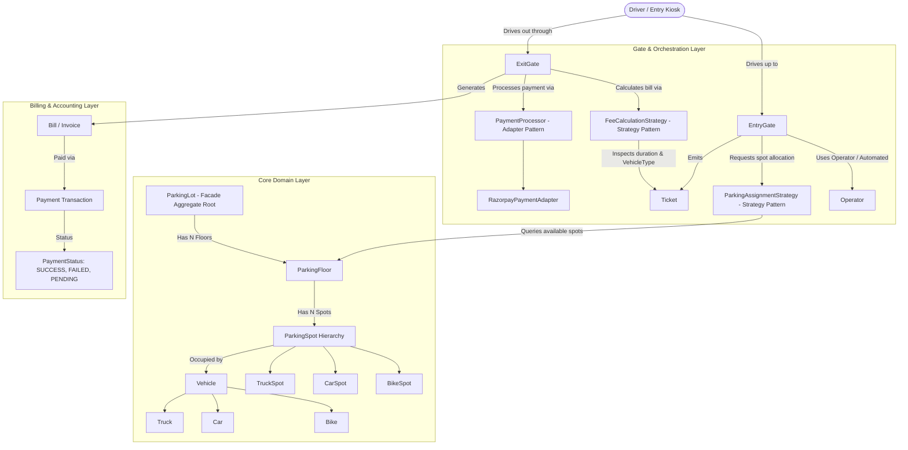

# Multi-Floor Parking Lot System — Architectural Blueprint & System Requirements

A production-grade, object-oriented Low-Level Design (LLD) specification for an automated Multi-Floor Parking Lot system with multi-vehicle support, dynamic spot allocation, tiered fee calculation, and payment gateway integration in Java 21 adhering to SOLID and GoF design patterns.

---

## 1. System Requirements Matrix

| # | Requirement | Implementation Details | Architectural Pattern / Component |
| :---: | :--- | :--- | :--- |
| **1** | **Multi-Floor Structure** | Multi-level facility with floors containing categorized parking spots. | `ParkingLot`, `ParkingFloor` |
| **2** | **Vehicle & Spot Segregation** | Strict sizing: `BIKE` $\to$ Bike Spot, `CAR` $\to$ Car Spot, `TRUCK` $\to$ Large/Truck Spot. Cross-parking strictly rejected. | `Vehicle`, `VehicleType`, `ParkingSpot`, `SpotType` |
| **3** | **Multiple Entry & Exit Gates** | Concurrent entry gates with human/automated operators generating tickets; exit gates processing billing. | `Gate`, `EntryGate`, `ExitGate`, `Operator` |
| **4** | **Pluggable Spot Assignment** | Strategy to allocate spots (e.g., nearest available spot to entry gate). Swappable without modifying core lot logic. | `ParkingAssignmentStrategy`, `NearestSpotAssignmentStrategy` (Strategy Pattern) |
| **5** | **Ticket Generation** | Unique ticket emitted at entry capturing `ticketId`, `entryTime`, `vehicle`, and `assignedSpot`. | `Ticket` (Value Object / Aggregate Record) |
| **6** | **Tiered Fee Calculation** | Progressive hourly slab pricing per vehicle type with partial-hour ceiling round-up. Extensible to dynamic/flat rates. | `FeeCalculationStrategy`, `TieredHourlyFeeStrategy` (Strategy Pattern) |
| **7** | **Payment Gateway Integration** | External integration with Razorpay to process UPI/Card payments without vendor lock-in. | `PaymentProcessor`, `RazorpayPaymentAdapter` (Adapter Pattern) |
| **8** | **Thread Safety & Double-Booking Guard** | Prevent race conditions when two entry gates attempt to assign the same optimal spot concurrently. | `ReentrantLock` / Atomic spot reservation (`ParkingSpot.park()`) |
| **9** | **System Construction & Assembly** | Fluent setup of floors, spots, gates, and operators with default configurations. | `ParkingLotBuilder` (Builder Pattern), `ParkingLot` (Facade Pattern) |

---

## 2. High-Level Architecture



---

## 3. Tiered Fee Calculation Model

The problem specifies **progressive slab pricing** with ceiling rounding:

$$\text{Billable Hours} = \lceil \text{Duration in Hours} \rceil$$

### Hourly Rate Slabs by Vehicle Type (₹ / hour)

| Vehicle Type | Hours 0 – 2 | Hours 2 – 4 | Hours 4 – 6 | Hours 6+ |
| :--- | :---: | :---: | :---: | :---: |
| **BIKE** | ₹20 | ₹25 | ₹30 | ₹40 |
| **CAR** | ₹25 | ₹30 | ₹35 | ₹45 |
| **TRUCK** | ₹50 | ₹60 | ₹65 | ₹80 |

#### Example Walkthrough (Car parked for 5.5 hours):
1. **Ceiling Rounding**: $5.5\text{ hrs} \to 6\text{ billable hours}$.
2. **Slab 1 (Hours 0–2, 2 hrs)**: $2 \times ₹25 = ₹50$.
3. **Slab 2 (Hours 2–4, 2 hrs)**: $2 \times ₹30 = ₹60$.
4. **Slab 3 (Hours 4–6, 2 hrs)**: $2 \times ₹35 = ₹70$.
5. **Total Final Bill**: $₹50 + ₹60 + ₹70 = \mathbf{₹180}$.

---

## 4. Key Design Patterns & Architectural Decisions

### 1. Strategy Pattern for Spot Assignment (`ParkingAssignmentStrategy`)
* **Problem**: Different parking lots prioritize different allocation algorithms (e.g., nearest to entry gate, ground floor first, distributed balance across floors, or VIP proximity).
* **Solution**: `EntryGate` delegates to `ParkingAssignmentStrategy.findSpot(ParkingLot, EntryGate, VehicleType)`.
* **Open/Closed Principle**: We can introduce `EcoElectricSpotStrategy` or `VIPSpotStrategy` without touching `EntryGate` or `ParkingLot`.

### 2. Strategy Pattern for Fee Calculation (`FeeCalculationStrategy`)
* **Problem**: Pricing schemes change frequently (e.g., dynamic weekend surge, flat event-day rates, subscription passes).
* **Solution**: `ExitGate` delegates to `FeeCalculationStrategy.calculateFee(Ticket, LocalDateTime exitTime)`.

### 3. Adapter Pattern for Payment Processing (`PaymentProcessor`)
* **Problem**: Integrating directly with 3rd-party vendor SDKs (`RazorpayClient`) tightly couples domain logic to proprietary APIs.
* **Solution**: Define a domain interface `PaymentProcessor` (`processPayment(PaymentRequest)`). Build `RazorpayPaymentAdapter` to translate domain calls into Razorpay SDK payloads. If switching to Stripe or Paytm later, only a new adapter is created.

### 4. Concurrency & Race-Condition Defense
* **Problem**: Multiple entry gates simultaneously query for the nearest spot and attempt to assign the same `CarSpot-101` to two different vehicles.
* **Solution**: Thread-safe reservation using lock guards or atomic compare-and-set:
  ```java
  public synchronized boolean assignVehicle(Vehicle vehicle) {
      if (!isAvailable) return false;
      this.currentVehicle = vehicle;
      this.isAvailable = false;
      return true;
  }
  ```

---

## 5. Domain Decomposition & Class Contracts

### Primitives & Enums
* `VehicleType`: `BIKE`, `CAR`, `TRUCK`.
* `ParkingSpotType`: `BIKE_SPOT`, `CAR_SPOT`, `TRUCK_SPOT`.
* `TicketStatus`: `ACTIVE`, `PAID`, `LOST`.
* `PaymentStatus`: `PENDING`, `COMPLETED`, `FAILED`, `REFUNDED`.
* `PaymentMode`: `UPI`, `CREDIT_CARD`, `DEBIT_CARD`, `CASH`.

### Core Entities
* **`Vehicle`** (Abstract base: `Bike`, `Car`, `Truck`).
* **`ParkingSpot`** (`spotId`, `floorNumber`, `type`, `isAvailable`, `currentVehicle`).
* **`ParkingFloor`** (`floorNumber`, `spotsByType`, `availableCountByType`).
* **`Ticket`** (`ticketId`, `vehicleNumber`, `vehicleType`, `assignedSpot`, `entryTime`, `entryGateId`).
* **`Bill`** (`billId`, `ticket`, `exitTime`, `durationHours`, `totalAmount`, `billStatus`).
* **`EntryGate`** / **`ExitGate`** (`gateId`, `operator`, gate operations).
* **`ParkingLot`** (Aggregate root coordinating floors, gates, and strategies).
