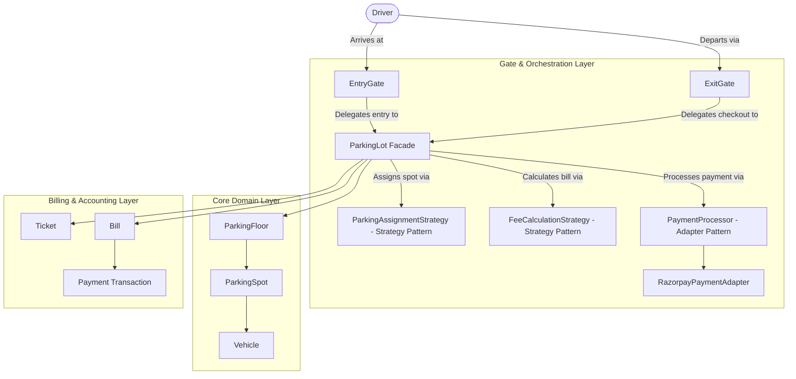

# Multi-Floor Parking Lot System — Low-Level Design (LLD)

A production-grade, object-oriented Low-Level Design for an automated Multi-Floor Parking Lot system with multi-vehicle support, dynamic spot allocation, tiered progressive fee calculation, and payment gateway integration in Java 21 adhering to clean architecture, SOLID principles, and GoF design patterns.

---

## 1. Problem Statement

### Requirements
1. **Multi-Floor Structure**: The parking lot will have multiple floors.
2. **Multiple Gates**: There will be multiple entry and exit gates.
3. **Vehicle & Spot Compatibility**: 
   - Supported vehicles: `CAR`, `BIKE`, `TRUCK`.
   - Strict spot allocation: Vehicles must park **only** in their designated spot types (e.g., a spot for `CAR` cannot be used to park `BIKE`s).
4. **Ticket Issuance at Entry**:
   - When a user enters via an entry gate, the operator generates a ticket.
   - The ticket contains: **Entry Time**, **Vehicle Number**, and **Assigned Parking Spot**.
   - **Spot Assignment Rule**: Parking spots should be assigned as per the **nearest available spot first** (i.e. find the nearest appropriate spot for a vehicle and assign it).
   - *Extensibility Requirement*: The way of assigning spots may change in the future (pluggable strategy).
5. **Bill Calculation at Exit**:
   - When the user decides to exit, they hand over the ticket to the operator at the exit gate, upon which their final bill is calculated.
   - Bill calculation depends on two factors:
     1. **Time spent** in the parking lot.
     2. **Vehicle type**.
   - *Extensibility Requirement*: This fee model may change in the future (pluggable strategy).
6. **Payment Gateway Integration**:
   - The system must integrate with **Razorpay** to process and manage payments.

---

## 2. Progressive Tiered Pricing Model

Billable duration is rounded **up** to the nearest whole hour ($\lceil \text{hours} \rceil$):

### Hourly Rate Slabs by Vehicle Type (₹ / hour)

| Vehicle Type | Hours 0 – 2 | Hours 2 – 4 | Hours 4 – 6 | Hours 6+ |
| :--- | :---: | :---: | :---: | :---: |
| **BIKE** | ₹20 | ₹25 | ₹30 | ₹40 |
| **CAR** | ₹25 | ₹30 | ₹35 | ₹45 |
| **TRUCK** | ₹50 | ₹60 | ₹65 | ₹80 |

#### Calculation Example (Car parked for 5.5 hours):
* **Ceiling Duration**: $5.5\text{ hrs} \to \mathbf{6\text{ billable hours}}$.
* **Slab 1 (Hours 0–2)**: $2 \times ₹25 = ₹50$.
* **Slab 2 (Hours 2–4)**: $2 \times ₹30 = ₹60$.
* **Slab 3 (Hours 4–6)**: $2 \times ₹35 = ₹70$.
* **Total Final Bill**: $₹50 + ₹60 + ₹70 = \mathbf{₹180}$.

---

## 3. High-Level Architecture

---

## 4. Documentation & Revision Links

* For all deep-dive architectural decisions, trade-offs, pattern analysis, and interview revision notes, see **[ParkingLotDesign.md](ParkingLotDesign.md)**.
