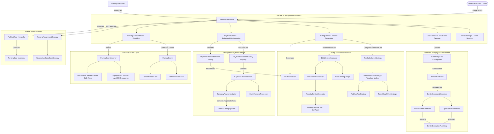
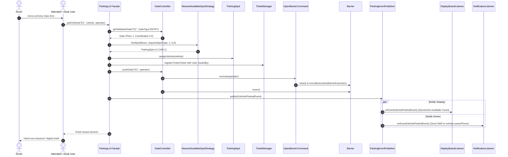
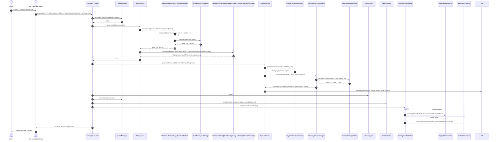
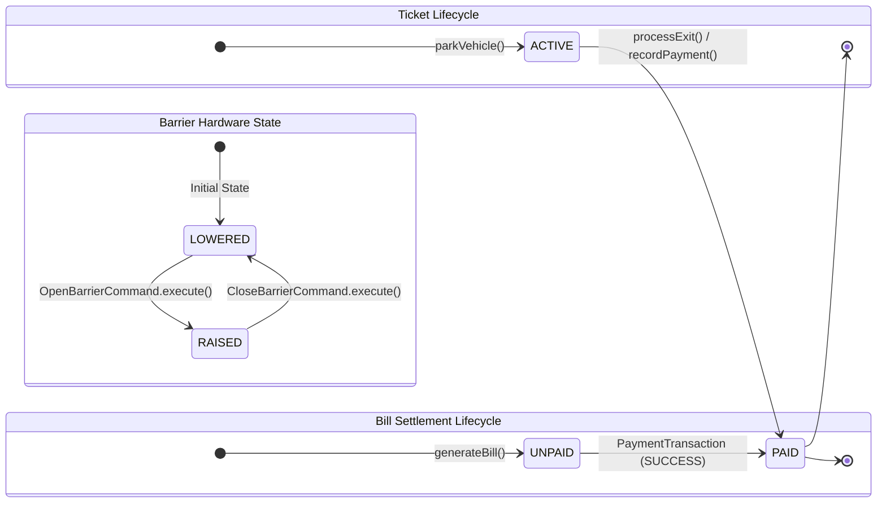

# Multi-Floor Parking Lot System — Low-Level Design (LLD)

[](https://openjdk.org/projects/jdk/21/)
[](pom.xml)
[](src/test/java/com/parkinglot)
[](ParkingLotDesign.md)

A production-grade, object-oriented Low-Level Design (LLD) for an automated Multi-Floor Parking Lot system in Java 21 adhering to clean architecture, SOLID principles, and Gang of Four (GoF) design patterns.

---

## 1. System Requirements & Feature Matrix

| # | Requirement | Implementation Details | Design Pattern / Component |
| :---: | :--- | :--- | :--- |
| **1** | **Multi-Floor Capacity** | Multi-level facility with categorized spots (`BIKE`, `CAR`, `TRUCK`). | `ParkingLot`, `ParkingFloor`, `ParkingSpot` |
| **2** | **Strict 1:1 Spot Sizing** | Type compatibility enforcement; prevents cross-parking. | `ParkingSpotType.canAccommodate(VehicleType)` |
| **3** | **Automated Ticket Issuing** | Entry ticket with timestamp, vehicle plate, spot, and operator audit. | `Ticket`, `User` (`issuedBy`) |
| **4** | **Spatial Spot Allocation** | Nearest available spot allocation using floor elevation delta first, then 2D Manhattan distance ($|x_1 - x_2| + |y_1 - y_2|$). | `ParkingAssignmentStrategy`, `NearestAvailableSpotStrategy` (Strategy Pattern) |
| **5** | **Progressive Slab Pricing** | Ceiling-rounded duration ($\lceil \text{hours} \rceil$) over progressive hourly slabs with the **₹180.00 Car Benchmark**. | `SlabBasedFeeStrategy`, `TieredHourlyFeeStrategy` (Template Method Pattern) |
| **6** | **Hardware Barrier Control** | Gates physically own `Barrier` hardware, actuated via commands with operator audit logging. | `Barrier`, `OpenBarrierCommand`, `CloseBarrierCommand` (Command Pattern) |
| **7** | **Itemized Amenity Billing** | Base parking tariffs decorated with dynamic EV charging and car wash services. | `BillableItem`, `BaseParkingCharge`, `BillableItemDecorator` (Decorator Pattern) |
| **8** | **Real-Time Observer Bus** | Decoupled event bus broadcasting entry/exit events to live LED display boards and driver SMS notifications. | `ParkingEventPublisher`, `DisplayBoardListener`, `NotificationListener` (Observer Pattern) |
| **9** | **Hexagonal Payment Architecture** | Decoupled payment port (`PaymentProcessor`) with pluggable adapters resolved via a dynamic registry. | `PaymentProcessorFactory`, `RazorpayPaymentAdapter`, `CashPaymentProcessor` (Adapter + Registry Pattern) |
| **10**| **Operational Policies** | Configurable grace periods, ceiling rounding intervals, and penalty caps without code modification. | `ParkingConfiguration` |
| **11**| **Fluent Construction** | Step-by-step lot assembly and immutable vehicle creation. | `ParkingLotBuilder`, `Vehicle.Builder` (Builder Pattern) |

---

## 2. High-Level Architecture Topology



---

## 3. Comprehensive UML Class Diagram

```mermaid
classDiagram
    direction TB

    class ParkingLot {
        -String lotId
        -List~ParkingFloor~ floors
        -ParkingAssignmentStrategy assignmentStrategy
        -TicketManager ticketManager
        -GateController gateController
        -BillingService billingService
        -PaymentService paymentService
        -ParkingEventPublisher eventPublisher
        +parkVehicle(gateId, vehicle, operator) Ticket
        +processExit(gateId, ticketNumber, exitTime, paymentMode, operator) Bill
        +subscribeToEvents(listener)
        +getAvailableSpotCount(type) int
    }

    class GateController {
        -Map~String, Gate~ gates
        +getValidatedGate(gateId, expectedType) Gate
        +openBarrier(gateId, operator)
        +closeBarrier(gateId, operator)
        +cycleGate(gateId, operator)
    }

    class Gate {
        -String gateId
        -GateType gateType
        -int floorNumber
        -Coordinates coordinates
        -Barrier barrier
        +open()
        +close()
        +isOpen() boolean
        +getBarrier() Barrier
    }

    class Barrier {
        -String barrierId
        -BarrierStatus status
        -List~BarrierExecution~ auditHistory
        +raise()
        +lower()
        +isRaised() boolean
        +recordExecution(execution)
    }

    class BarrierCommand {
        <<interface>>
        +execute(operator)
        +getCommandName() String
    }

    class OpenBarrierCommand {
        -Barrier barrier
        +execute(operator)
    }

    class CloseBarrierCommand {
        -Barrier barrier
        +execute(operator)
    }

    class TicketManager {
        -Map~String, Ticket~ activeTickets
        +registerTicket(ticket)
        +getActiveTicketOrThrow(ticketNumber) Ticket
        +closeTicket(ticketNumber) Ticket
    }

    class BillingService {
        -FeeCalculationStrategy feeStrategy
        +generateBill(ticket, exitTime) Bill
    }

    class BillableItem {
        <<interface>>
        +getCost() double
        +getItemizedLines() List~String~
    }

    class BaseParkingCharge {
        -double cost
        +getCost() double
        +getItemizedLines() List~String~
    }

    class BillableItemDecorator {
        <<abstract>>
        #BillableItem wrappedItem
        +getCost() double
        +getItemizedLines() List~String~
        #getAdditionalCost()* double
        #getItemizedLine()* String
    }

    class AmenityServiceDecorator {
        -AmenityService amenityService
        #getAdditionalCost() double
        #getItemizedLine() String
    }

    class PaymentService {
        -PaymentProcessorFactory paymentProcessorFactory
        +processBillPayment(bill, mode, operator) PaymentTransaction
    }

    class PaymentProcessorFactory {
        -Map~PaymentMode, PaymentProcessor~ registry
        +registerProcessor(mode, processor)
        +getPaymentProcessor(mode) PaymentProcessor
    }

    class PaymentProcessor {
        <<interface>>
        +processPayment(billId, amount, mode, operator) PaymentTransaction
    }

    class RazorpayPaymentAdapter {
        -ExternalRazorpayClient razorpayClient
        +processPayment(billId, amount, mode, operator) PaymentTransaction
    }

    class CashPaymentProcessor {
        +processPayment(billId, amount, mode, operator) PaymentTransaction
    }

    class FeeCalculationStrategy {
        <<interface>>
        +calculateFee(ticket, exitTime) double
    }

    class SlabBasedFeeStrategy {
        <<abstract>>
        #Map~VehicleType, List~PricingSlab~~ slabsByVehicleType
        #ParkingConfiguration configuration
        +calculateFee(ticket, exitTime) double
        #computeSlabFee(billableHours, slabs)* double
    }

    class TieredHourlyFeeStrategy {
        #computeSlabFee(billableHours, slabs) double
    }

    class ParkingEventPublisher {
        -List~ParkingEventListener~ listeners
        +subscribe(listener)
        +publish(event)
    }

    ParkingLot *-- TicketManager
    ParkingLot *-- GateController
    ParkingLot *-- BillingService
    ParkingLot *-- PaymentService
    ParkingLot *-- ParkingEventPublisher
    GateController o-- Gate
    Gate *-- Barrier
    BarrierCommand <|.. OpenBarrierCommand
    BarrierCommand <|.. CloseBarrierCommand
    OpenBarrierCommand --> Barrier
    CloseBarrierCommand --> Barrier
    BillingService o-- FeeCalculationStrategy
    FeeCalculationStrategy <|.. SlabBasedFeeStrategy
    SlabBasedFeeStrategy <|-- TieredHourlyFeeStrategy
    BillableItem <|.. BaseParkingCharge
    BillableItem <|.. BillableItemDecorator
    BillableItemDecorator <|-- AmenityServiceDecorator
    PaymentService o-- PaymentProcessorFactory
    PaymentProcessorFactory o-- PaymentProcessor
    PaymentProcessor <|.. RazorpayPaymentAdapter
    PaymentProcessor <|.. CashPaymentProcessor
```



---

## 4. Key Dynamic Sequence Flows

### 4.1 Flow 1: Vehicle Entry & Spot Allocation


### 4.2 Flow 2: Exit Settlement & Decorator Billing


### 4.3 Flow 3: Hardware Barrier Command Actuation & Operator Audit
```mermaid
sequenceDiagram
    autonumber
    actor Attendant as Attendant (Carlos)
    participant GC as GateController
    participant OP as OpenBarrierCommand
    participant CL as CloseBarrierCommand
    participant B as Barrier Hardware

    Note over Attendant, B: Vehicle approaches gate; operator actuates barrier
    Attendant ->> GC: openBarrier("E1", operator)
    GC ->> OP: execute(operator)
    OP ->> B: raise()
    OP ->> B: recordExecution(new BarrierExecution("BARRIER-E1", "OPEN_BARRIER", Carlos))
    Note over B: Barrier status is RAISED; audit history recorded

    Note over Attendant, B: Vehicle safely passes induction loop sensor
    Attendant ->> GC: closeBarrier("E1", operator)
    GC ->> CL: execute(operator)
    CL ->> B: lower()
    CL ->> B: recordExecution(new BarrierExecution("BARRIER-E1", "CLOSE_BARRIER", Carlos))
    Note over B: Barrier status is LOWERED; complete audit trail retained
```

---

## 5. Entity Lifecycle State Machines



---

## 6. Hourly Pricing Rate Matrix & The ₹180.00 Benchmark

| Vehicle Type | 0 - 2 Hours | 2 - 4 Hours | 4 - 6 Hours | 6+ Hours |
| :--- | :--- | :--- | :--- | :--- |
| **BIKE** | ₹20 / hr | ₹25 / hr | ₹30 / hr | ₹40 / hr |
| **CAR** | ₹25 / hr | ₹30 / hr | ₹35 / hr | ₹45 / hr |
| **TRUCK** | ₹50 / hr | ₹60 / hr | ₹65 / hr | ₹80 / hr |

### The ₹180.00 Car Benchmark Walkthrough
**Example**: A `CAR` enters at `10:00 AM` and exits at `03:30 PM`.
1. **Raw Duration**: 5 hours, 30 minutes = 5.5 hours.
2. **Ceiling Rounding**: $\lceil 5.5 \rceil = 6 \text{ billable hours}$.
3. **Progressive Slab Breakdown**:
   * **Slab 1 (Hours 0 to 2 = 2 hrs)**: $2 \times ₹25 = \mathbf{₹50}$
   * **Slab 2 (Hours 2 to 4 = 2 hrs)**: $2 \times ₹30 = \mathbf{₹60}$
   * **Slab 3 (Hours 4 to 6 = 2 hrs)**: $2 \times ₹35 = \mathbf{₹70}$
   * **Slab 4 (Hours 6+ = 0 hrs)**: $0 \times ₹45 = \mathbf{₹0}$
4. **Total Base Fee**: $₹50 + ₹60 + ₹70 = \mathbf{₹180.00}$.

---

## 7. Design Patterns Applied

| Pattern | Category | Where Applied | Concrete Architectural Justification |
| :--- | :--- | :--- | :--- |
| **Facade** | Structural | `ParkingLot` class | Orchestrates specialized delegates (`GateController`, `TicketManager`, `BillingService`, `PaymentService`, `ParkingEventPublisher`). |
| **Strategy (x2)** | Behavioral | `ParkingAssignmentStrategy`<br>`FeeCalculationStrategy` | **1.** Swaps spatial spot allocation heuristics.<br>**2.** Swaps progressive fee slab calculations. |
| **Command** | Behavioral | `BarrierCommand`<br>`OpenBarrierCommand`<br>`CloseBarrierCommand` | Encapsulates barrier hardware movements with operator audit logging. |
| **Decorator** | Structural | `BillableItemDecorator`<br>`AmenityServiceDecorator` | Dynamically decorates base charges with consumed amenities using the Template Method pattern inside the decorator. |
| **Observer** | Behavioral | `ParkingEventPublisher`<br>`ParkingEventListener` | Decouples core parking lot logic from LED display updates and driver SMS receipts. |
| **Template Method** | Behavioral | `SlabBasedFeeStrategy`<br>`BillableItemDecorator` | Enforces invariant algorithm structure (`final calculateFee()`) while letting subclasses implement rate math hooks. |
| **Adapter** | Structural | `RazorpayPaymentAdapter` | Bridges third-party SDK calls (`ExternalRazorpayClient`) into clean domain contracts. |
| **Registry / Factory** | Creational / Behavioral | `PaymentProcessorFactory` | Maps `PaymentMode` to domain `PaymentProcessor` abstractions via a dynamic registry, completely decoupled from vendor SDKs. |
| **Builder (x2)** | Creational | `ParkingLotBuilder`<br>`Vehicle.Builder` | Assembles complex lots and builds rich vehicle records without telescoping constructors. |

---

## 8. Package Structure & Bounded Contexts

```
com.parkinglot/
├── ParkingLot.java                         # Facade entry point
├── builder/
│   └── ParkingLotBuilder.java              # Fluent builder for parking lot hierarchy
├── command/                                # Command Pattern for barrier actuation
│   ├── BarrierCommand.java
│   ├── OpenBarrierCommand.java
│   ├── CloseBarrierCommand.java
│   └── BarrierExecution.java
├── config/                                 # Operational policy configuration
│   └── ParkingConfiguration.java
├── enums/                                  # Domain enumerations
│   ├── BarrierStatus.java
│   ├── BillStatus.java
│   ├── GateType.java
│   ├── ParkingSpotType.java
│   ├── PaymentMode.java
│   ├── TicketStatus.java
│   ├── UserRole.java
│   ├── VehicleType.java
│   └── WashPackage.java
├── event/                                  # Observer Pattern event bus
│   ├── ParkingEvent.java
│   ├── ParkingEventListener.java
│   ├── ParkingEventPublisher.java
│   ├── VehicleExitedEvent.java
│   ├── VehicleParkedEvent.java
│   └── listener/
│       ├── DisplayBoardListener.java
│       └── NotificationListener.java
├── model/                                  # Domain entities & value objects
│   ├── Barrier.java
│   ├── Coordinates.java
│   ├── Gate.java
│   ├── ParkingFloor.java
│   ├── ParkingSpot.java
│   ├── Ticket.java
│   ├── User.java
│   └── Vehicle.java
├── billing/                                # Billing & settlement domain
│   ├── Bill.java
│   ├── BillingService.java
│   ├── decorator/                          # Decorator Pattern for itemized invoices
│   │   ├── BillableItem.java
│   │   ├── BaseParkingCharge.java
│   │   ├── BillableItemDecorator.java
│   │   └── AmenityServiceDecorator.java
│   └── service/
│       ├── AmenityService.java
│       ├── CarWashService.java
│       └── EvChargingService.java
├── payment/                                # Hexagonal payment domain
│   ├── PaymentProcessor.java
│   ├── PaymentProcessorFactory.java        # Registry / Factory pattern
│   ├── PaymentService.java
│   ├── PaymentStatus.java
│   ├── PaymentTransaction.java
│   ├── adapter/
│   │   └── RazorpayPaymentAdapter.java
│   ├── external/
│   │   └── ExternalRazorpayClient.java
│   └── processor/
│       └── CashPaymentProcessor.java
├── service/                                # Subsystem delegates
│   ├── GateController.java
│   └── TicketManager.java
└── strategy/                               # Strategy patterns
    ├── assignment/
    │   ├── NearestAvailableSpotStrategy.java
    │   └── ParkingAssignmentStrategy.java
    └── fee/
        ├── FeeCalculationStrategy.java
        ├── FlatRateFeeStrategy.java
        └── slab/
            ├── PricingSlab.java
            ├── SlabBasedFeeStrategy.java    # Template Method pattern
            └── TieredHourlyFeeStrategy.java
```

---

## 9. Build & Test Verification

```bash
mvn clean test
```

70 automated tests covering:
- Spatial distance heuristics & elevation preferences
- Progressive hourly pricing & the ₹180.00 Car benchmark with Template Method enforcement
- Physical barrier actuation & command execution audits
- Decorator pattern itemized billing & amenity chaining
- Event-driven live occupancy tracking & driver SMS dispatching
- Operator accountability on tickets and payment transactions
- Dynamic PaymentProcessorFactory registry resolution
- Concurrency and thread safety across entry/exit gates
