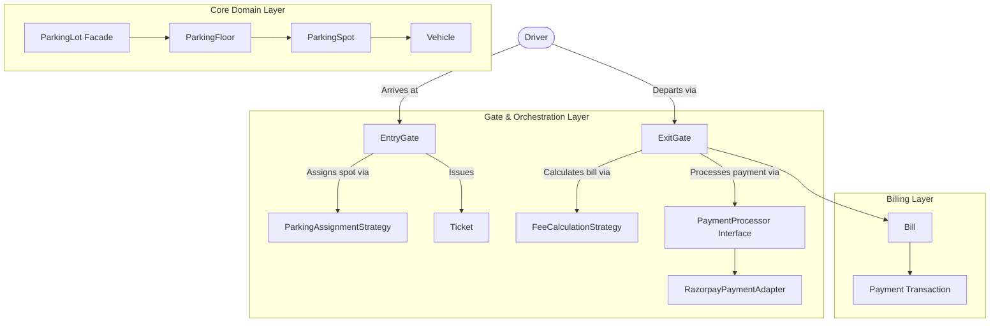

# Multi-Floor Parking Lot System — Low-Level Design (LLD)

A production-grade, object-oriented Low-Level Design for an automated Multi-Floor Parking Lot system with multi-vehicle support, dynamic spot allocation, tiered fee calculation, and payment gateway integration in Java 21 adhering to clean architecture, SOLID principles, and GoF design patterns.

---

## 1. System Requirements & Feature Matrix

| # | Requirement | Implementation Details | Design Pattern / Component |
| :---: | :--- | :--- | :--- |
| **1** | **Multi-Floor Structure** | Multi-level facility with categorized spots (`BIKE`, `CAR`, `TRUCK`). | `ParkingLot`, `ParkingFloor` |
| **2** | **Vehicle & Spot Segregation** | Vehicle size constraint validation; strict prevention of cross-parking. | `Vehicle`, `ParkingSpot`, `ParkingSpotType` |
| **3** | **Multiple Entry & Exit Gates** | Concurrent entry gates with operator ticket issuing; exit gates processing billing. | `EntryGate`, `ExitGate`, `Operator` |
| **4** | **Pluggable Spot Assignment** | Nearest available spot allocation (distance-aware across floors & coordinates). | `ParkingAssignmentStrategy`, `NearestAvailableSpotStrategy` (Strategy Pattern) |
| **5** | **Ticket Lifecycle** | Entry ticket with timestamp, vehicle number, and allocated spot. | `Ticket` (Domain Entity) |
| **6** | **Tiered Progressive Fee Model** | Hourly slab billing with partial-hour ceiling round-up. | `FeeCalculationStrategy`, `TieredHourlyFeeStrategy` (Strategy Pattern) |
| **7** | **Payment Gateway Integration** | Vendor-agnostic payment processing via Razorpay integration. | `PaymentProcessor`, `RazorpayPaymentAdapter` (Adapter Pattern) |
| **8** | **Thread Safety & Double-Booking Guard** | Prevents race conditions when multiple gates allocate the same spot simultaneously. | Atomic spot locking (`ParkingSpot.assignVehicle()`) |
| **9** | **Fluent Assembly & Facade** | Step-by-step setup of floors, gates, and pricing strategies. | `ParkingLotBuilder` (Builder Pattern), `ParkingLot` (Facade Pattern) |

---

## 2. High-Level Architecture

---

## 3. Detailed Specifications

For complete mathematical fee models, class contracts, and design pattern justifications, see [ParkingLotDesign.md](ParkingLotDesign.md).
